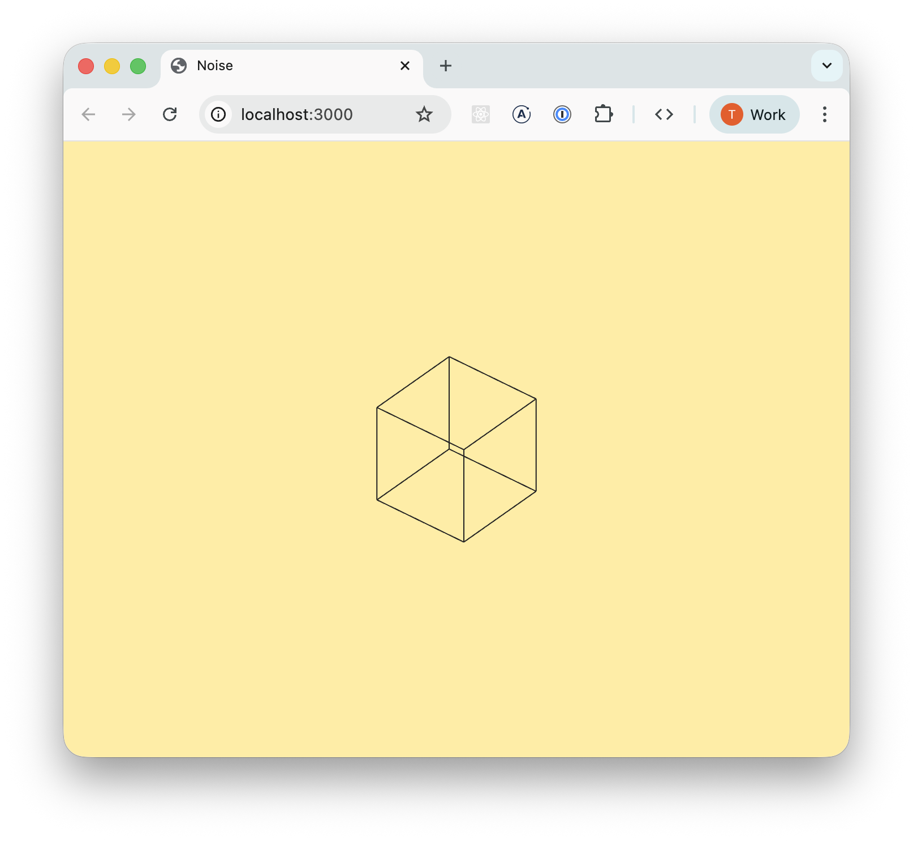

# Noise

Noise is a wire-frame software renderer. I built it as a learning exercise to deepen my understanding of the linear algebra and matrix math involved in projecting a 3D scene onto a 2D plane. Moving the mouse changes the rotation of the square, not the viewer, but the matrix is the usual one calculated as the inverse of the viewer as the viewer essentially stays still and the scene moves.

  

The rendering is built as a pipeline with each stage adding a transformation until it's finally projected.
